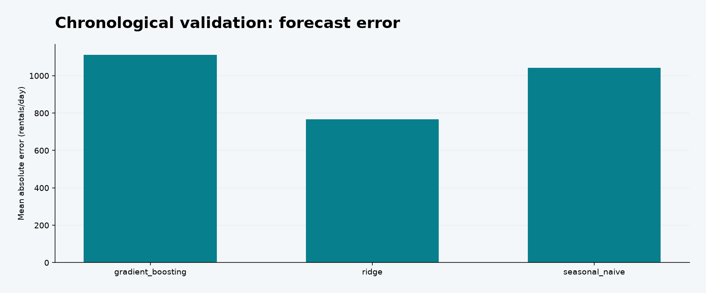

# Demand Forecasting Operations

Can tomorrow’s rental demand be forecast more accurately than last week’s, with useful uncertainty for service capacity planning?

Final-holdout MAE **905 rentals/day**, **25.6% below seasonal naive**. Nominal-90% interval coverage is **85.3%**, exposing remaining uncertainty calibration risk.



## Run locally

Tested with Python 3.13. Install the pinned dependencies in an isolated environment:

```bash
python3 -m venv .venv
source .venv/bin/activate
python -m pip install -r requirements.txt
python -m unittest -v
python pipeline.py
```

On Windows use `.venv\Scripts\activate` for activation. The first pipeline run downloads the public source into `.cache/` (except the synthetic experiment). Later runs reuse it. Delete only that cache if you intentionally want a fresh source download. `metrics.json` records the source SHA-256 so a changed upstream dataset can be detected.

Open **dashboard.html** locally for interactive charts, zoom, hover and legend toggles. It is self-contained and needs no API key, server or CDN. GitHub displays HTML source rather than running dashboards: download the repository ZIP, extract it, then open the file. Read [FINDINGS.md](FINDINGS.md) for the decision memo and [analysis.ipynb](analysis.ipynb) for the walkthrough.

## Analysis architecture

```text
Daily source checks → causal lags/calendar features → expanding-window selection → disjoint residual calibration → final one-day-ahead holdout → capacity sensitivity.
```

- Validates a complete daily grid and reconciles casual + registered riders to total rentals.
- Uses only lagged demand and known calendar features; excludes contemporaneous weather and target components.
- Compares seasonal naive, ridge and gradient boosting across three expanding training windows.
- Freezes the validation-selected model before a separate 100-day interval calibration window and final holdout.
- Reports MAE, RMSE, WAPE, nominal-90% interval coverage and hypothetical shortage/surplus costs.

## Data and metric contracts

`dteday`: day. `cnt`: observed daily rental count. `casual`, `registered`: components used only for reconciliation. `holiday`, `workingday`: known calendar indicators. `lag_1/7/14`: prior observed target values. `mean_7/28`, `std_7`: shifted rolling summaries. Cyclic day/week features and trend are calendar-derived. Forecast outputs are rental flows, not station inventory.

Source attribution, download policy and license boundaries are in [DATA.md](DATA.md). KPI denominators and decision rules are explicit in the pipeline. Generated results are committed so the conclusions can be inspected without executing code.

## Outputs

`backtest_folds.csv`, `test_predictions.csv`, `capacity_scenarios.csv`, `metrics.json`.

`pipeline.py` owns analytical calculations; `reporting.py` only downloads, fingerprints and renders. SQL files provide the corresponding warehouse-style aggregations. `test_pipeline.py` checks failure modes such as temporal leakage, invalid capacities, duplicate handling or SRM gating. [VALIDATION.md](VALIDATION.md) records the executed checks.

## Limitations and decisions

Forecasts are rolling one-day-ahead with actual history updated daily; they are not a fixed-origin multi-day forecast. Model parameters stay fixed after training. Time dependence and drift invalidate exchangeable conformal guarantees, so observed coverage is reported. Two years do not capture all regimes. Planning costs are hypothetical.

## Next engineering step

Incorporate forecast-vintage weather, station-level stock/rebalancing constraints, and an adaptive calibration protocol evaluated before deployment.

## License

MIT for project code. Third-party data keep their source terms. See [LICENSE](LICENSE) and [DATA.md](DATA.md).
